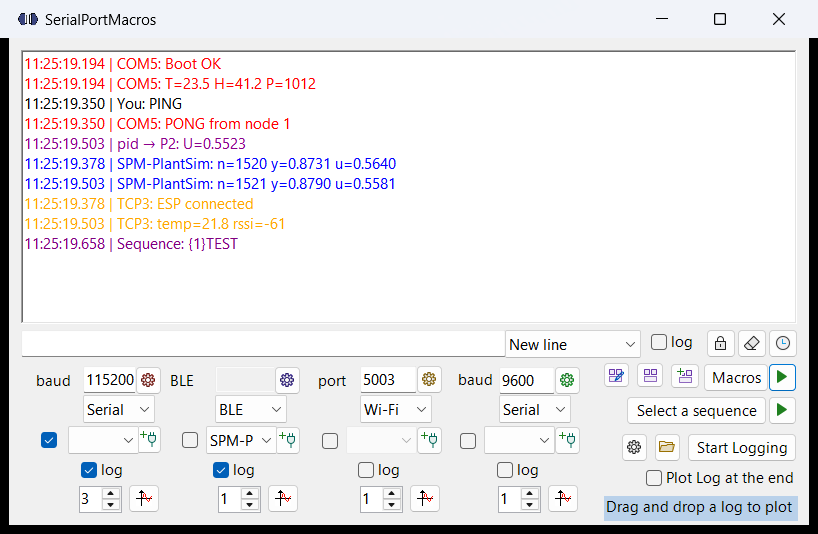
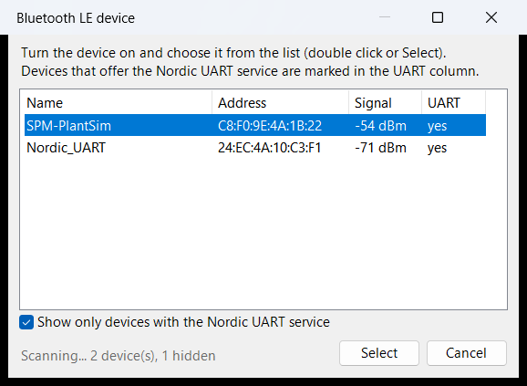
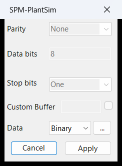
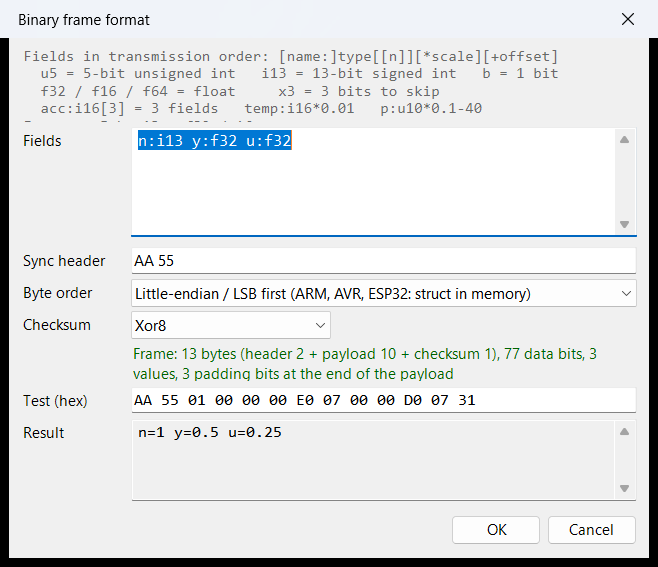
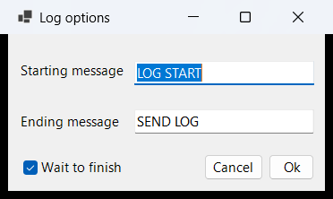
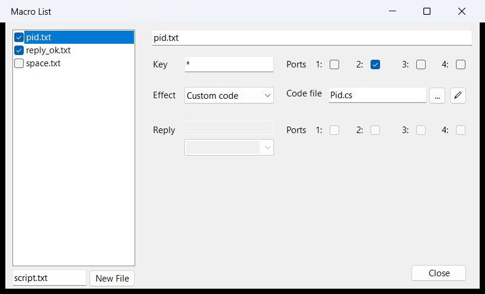
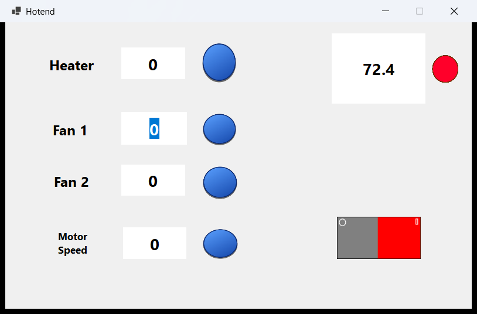
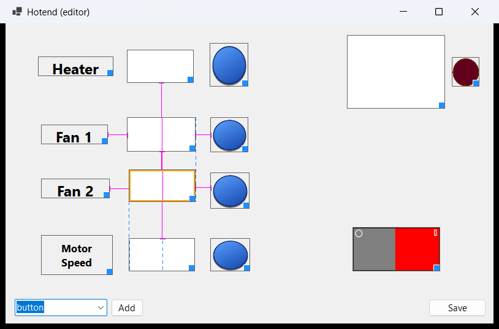

# SerialPortMacros
A C# program to talk with up to 4 devices at the same time over **serial ports, Wi-Fi (TCP) or Bluetooth LE**: it shows and logs what they send, plots their values in real time, reacts to their messages with macros (from simple key presses to your own C# code), runs scripted sequences of commands and lets you build custom control panels ("interfaces").



[I've also made a short video to show some capabilities of this software](https://www.youtube.com/watch?v=STqCw-Kn7qI)

**Contents**
- [The main window](#the-main-window)
- [Ports: Serial, Wi-Fi (TCP) and Bluetooth LE](#ports-serial-wi-fi-tcp-and-bluetooth-le)
- [Binary data](#binary-data)
- [Logging](#logging)
- [Plotting a log](#plotting-a-log)
- [Plotting in real time](#plotting-in-real-time)
- [Macro Menu](#macro-menu)
- [Custom code macros](#custom-code-macros)
- [Sequences](#sequences)
- [Interfaces](#interfaces)
- [ESP32 examples](#esp32-examples)
- [Requirements](#requirements)

# The main window
Each port is a column of controls at the bottom of the window. The text received or sent is displayed with a different color based on the sender:
- the color of a port is the same as the cog of its settings button;
- the text sent by you is black;
- the text sent by a macro is brown (write back) or purple/magenta (interfaces, sequences, custom code).

You can type in the text box and press Enter to send a line to every port whose check box is ticked (the one next to the port list); the combo box next to the text box chooses the line ending. The up/down arrows recall the last 50 commands.

You can clear the display by clicking the eraser button. You can also toggle auto-scroll with the lock button and toggle the timestamp with the clock button.

The program never slows down the data: logging, macros and plots receive every message, while the text on screen is refreshed at its own pace. If a device sends faster than the window can show, some lines are skipped **on screen only** and a gray line tells you how many (`··· N lines not shown ···`); the log files still contain everything.

All options are saved each time the program closes.

# Ports: Serial, Wi-Fi (TCP) and Bluetooth LE
Each port has a mode selector under its value box:

| Mode | How to use it |
|---|---|
| **Serial** | Select the COM port from the list, set the baud rate and click the connect button. |
| **Wi-Fi** | The program listens as a TCP server on the given port (the box shows "port" instead of "baud"); your device (e.g. an ESP32) connects to the PC's IP address on that port. Two ports cannot use the same TCP port: a free one is assigned automatically. |
| **BLE** | Bluetooth LE with the Nordic UART Service (the usual "serial over BLE"). Choosing BLE opens a window with the nearby devices; the chosen one appears in the port list (click the list to choose another one). The connect button connects and disconnects; if the link drops, Windows reconnects by itself. |



Devices that offer the Nordic UART Service are marked in the UART column and listed first. The service UUIDs are:
service `6E400001-B5A3-F393-E0A9-E50E24DCCA9E`, RX (written by the PC) `6E400002-…`, TX (notified by the device) `6E400003-…`.

The cog button of each port opens its settings: parity, data bits, stop bits and buffer size (serial mode only), and the **data format** (text or binary, see below).



Whatever the mode, the received data goes through the same path: log, plots, macros and interfaces work the same way on serial, Wi-Fi and BLE.

# Binary data
By default a port reads text lines. In the port settings you can switch **Data** to **Binary** and describe a binary frame, so a microcontroller can send compact bit fields instead of text. Each frame is decoded into numbers, shown as text (e.g. `n=1520 y=0.8731 u=0.564`) and used exactly like numbers read from text: plots, logs, macros and interfaces.



Fields are listed in transmission order, separated by spaces: `[name:]type[[n]][*scale][+offset]`

| Field | Meaning |
|---|---|
| `u5`, `u13`, `u32` | unsigned integer (1 to 64 bits) |
| `i6`, `i16` | signed integer, two's complement (2 to 64 bits) |
| `b` | a single bit |
| `f32`, `f16`, `f64` | IEEE-754 float |
| `x3` | 3 bits to skip (padding) |
| `acc:i16[3]` | repeated field → `acc0 acc1 acc2` |
| `temp:i16*0.01`, `p:u10*0.1-40` | scale and offset applied to the value |

For example `n:i13 y:f32 u:f32` is 77 bits (10 bytes with padding).

- **Sync header** (e.g. `AA 55`): bytes that start every frame. Strongly recommended: it lets the program find the start of the next frame if a byte is lost.
- **Byte order**: little-endian (default) is what you get when an ARM, AVR or ESP32 copies a variable or struct from memory; big-endian is the network order.
- **Checksum** (optional, after the payload): Sum8, Xor8, Crc8, Crc16Modbus, computed on the payload.
- **Test (hex)**: paste some bytes to see immediately how they are decoded.

The [ESP32 examples](#esp32-examples) show how to pack the bits on the microcontroller side.

# Logging


By checking the log option under a port, you will enable logging for that port. If you do, when using the logging feature, a text file corresponding to that port will be created in the logs folder* in the same directory as the exe file. This file will contain the log of all that was written by that port; if the timestamp option is enabled, the timestamp will also be written (the name of the sender is only visible if the sender is the user in this case).

If two or more ports are selected, the software will write an additional file containing the log of all ports (in this case, the name of the sender will also be written).

By checking the log option near the text box, you will also be logging user inputs.

\* This folder can be opened with a dedicated button

## Logging data stored on the device
Some devices record their data and send it all at the end (for example a data logger that stores samples in RAM while it runs). The cog button next to "Start Logging" opens the log options:



- **Starting message**: sent to the ports when you press "Start Logging" (e.g. to tell the device to start recording);
- **Ending message**: sent when you press the button again (e.g. "send me the log");
- **Wait to finish**: instead of closing the log files immediately, the program keeps logging while the device is sending its data, and closes them automatically when nothing has arrived for 1 second.

# Plotting a log


By checking the "Plot Log at the end" option the program will automatically open a dedicated window to plot the log:


The program takes any line containing a set of numbers spaced with any delimiter (different from ".") from a port and interprets each number in the string as a different vector
e.g.
The string:
132.50,-76457.00,847.36
will be interpreted as the values of 3 different plots at the same sample.

The program will automatically decide what format the data is in and will ignore any line different from the main format (so it decides how many plots from the data and then sticks to that), to prevent it from choosing a wrong format due to random messages. The program will check that the chosen format has at least "minimum occurrences" lines with that format; this value can be changed to make sure you exclude known ambiguous lines.


Each plot will be shown as an "element" in the table on the right; if a plot is checked, it will be displayed.
In addition, in the table one can set a gain and a low-pass filter cutoff frequency (only available in x-axis auto mode).

The x-axis can be set to two different modes:
- Auto: each element is considered sampled at a fixed sampling rate chosen by the user.
- Use an element as time base: one of the element vectors can be used as the x-axis.
e.g.
132.50,-76457.00,847.36, 51
Will consider 51 as the timestamp of the elements 132.50,-76457.00,847.36 in the plot

One can also open an old log with the drag and drop feature, which functions identically to the window that opens after a log if the box is checked.

# Plotting in real time


Under each port, you can find a button to open the graphs; the number near the button decides how many plots will be opened. When reading the lines of a port, the software will associate the first number in the line to the first graph, the second number to the second graph, and so on. There are no defined delimiters; just make sure to add something between your numbers that isn't a dot (used for decimals). With a binary port, the decoded fields are plotted in the order they are defined. In the plot window, you can also select how long the time window should be.

## Merging graphs
You can also merge two graphs by using the merge button

In the image, the graph on the right is looking to merge. After clicking the merge button on a second graph, the two windows will become invisible, and a new merged window will appear


You can toggle the legend by clicking the eye icon at the bottom.
You can show the original windows by clicking the new unmerge button; this will not close the merged window.
If you close the merged graph, the original graphs will show up again.
There is no hard limit on the number of graphs you can plot together.

# Macro Menu


This program is meant to interact with your electronic projects, the idea is to associate a string sent by your device to an action made by your computer: it can press a key in response to a certain string, send a string to the selected ports in response to a string on the selected ports (to coordinate multiple devices), or run your own C# code.

You can easily make your macros with this menu. Use "New File" to create a new macro. You can then:

  1) See the name

  2) Set the key(*), which will let you decide the keyword that will trigger the action

  3) Set the ports that will be monitored for the key of this script

  4) Set the effect: "Keypress", "Write back" or "Custom code"

  5) If you select keypress, you will want to set the keypress(**)

  6) If you select "write back" you will want to set the reply, the line ending and check on which ports it will be sent

  7) If you select "custom code" you will want to choose the code file (see [Custom code macros](#custom-code-macros))

Once you've made the macro, you will be able to enable it or disable it by checking its checkbox. Macros run while the play button next to "Macros" is pressed; pressing play also reloads the macro files.

## (**)Keypress format
In the keypress text box, you can:

  1) Use a character by its virtual-key code value (https://learn.microsoft.com/en-us/windows/win32/inputdev/virtual-key-codes):
    to do so: add a * at the start
      example: "*0x20" will press the 'SPACE' key;

  2) Write a single character you want to press. This is mostly meant to be used with alphanumeric characters; for letters, you will have to use the capital letter
      example: "A" will press the a key;

  3) Add a '+' before the key to press down the key '-' to release the key
      example: "+A" will start pressing the 'a' key;
      example: "-A" will stop pressing the 'a' key;
      example: "*+0x20" will start pressing the 'SPACE' key;

  4) Add a '%' before and after the key (it's either +/-/%) and then a time to press it, the program will keep the button pressed for the specified time
      example: "%1000%A" will keep the 'a' key pressed for 1000ms or 1s;
      example: "%1000%0x20" will keep the 'SPACE' key pressed for 1000ms or 1s;

  5) Write a string that will be typed out

  6) There are three other strings that you can use for useful stuff
      !LMB will press the left mouse button;
      !RMB will press the right mouse button;
      !MMB will press the middle mouse button;

## (*)Key format
  1) The program will look for the incoming strings that contain the key (not necessarily just the key)

  2) If you set the macro key and keypress to "===" and send through the serial port a message beginning in "===" followed by a keypress, the program will interpret and press that key (all previous formats apply)
      Example: "===+A" sent by your device through the serial port will make the program start pressing the A key;

  3) If you set the macro key to "*" it will react to every message regardless of the content (useful for write back and custom code)

# Custom code macros
With the "Custom code" effect a macro runs your own C# code: it receives the message and the port it came from, and can send any message to any port. It can keep a state between messages, so you can write things like a PID controller, a protocol translator between two devices, a filter...

The code is a `.cs` file in the `custom_macros` folder next to the exe (or any file chosen with the "..." button). The pencil button creates the file from a template and opens it. The file is compiled automatically when you press play; if there are errors, they are shown in red in the main window with line and column. A compiled `.dll` can be used as well.

The simplest form: a port and a string in, a port and a string out.

```csharp
public class Echo : SimpleMacro
{
    public override (int Port, string Message)? OnMessage(int port, string message)
    {
        if (message.StartsWith("PING"))
            return (port, "PONG");     // port 0 = same port, -1 = all ports
        return null;                   // nothing to send
    }
}
```

The full form gives you more:

```csharp
public class MyMacro : ICustomMacro
{
    IMacroContext ctx;
    double integral;                                   // fields keep their value between messages

    public void Start(IMacroContext context) { ctx = context; integral = 0; }   // play pressed

    public IEnumerable<MacroOutput> Process(MacroInput input)
    {
        // input.Port (1..4), input.Message, input.Values (numbers of the line or binary fields),
        // input.Time (seconds, handy to compute dt)
        double sp = ctx.Variables.GetOrAdd("setpoint", 1.0);   // shared with the interfaces
        yield return MacroOutput.Line(2, "U=" + (sp - input.Values[0]));
    }

    public void Stop() { }                                      // macros stopped or reloaded
}
```

- Outputs: `MacroOutput.Line(port, text)`, `MacroOutput.Raw(port, text)`, `MacroOutput.Bytes(port, bytes)`, `MacroOutput.Reply(text)`.
- `ctx.Variables` are the same variables used by the [interfaces](#interfaces): a panel can set a value read by the macro, or show a value computed by it.
- `ctx.Send(port, text)` can also be called from your own timer or thread; `ctx.Print(text)` writes in the main window.
- The code runs for every message that matches the key and ports of the macro, never twice at the same time: keep it fast.

A complete example is the PID controller in [`Examples/custom_macros/Pid.cs`](SerialPortMacros_Source/Examples/custom_macros/Pid.cs).

# Sequences
A sequence is a text file with a list of commands sent one after the other, for example to run the same test on your device every time.

```
{1}START{NL}
{wait(500)}
{1,3}SPEED 100{NL}
{wait(2000)}
{2}STOP{CR}
```

- `{1,3}text{NL}` sends `text` to ports 1 and 3; the line ending is `{NL}`, `{CR}`, `{NLCR}` or `{N}` (none);
- `{wait(500)}` waits 500 ms.

Click "Select a sequence" to choose the file (from the `sequences` folder), then the play button next to it to start. The same button pauses and resumes the sequence. Every command is shown in the main window (and logged, if logging of your inputs is on).

# Interfaces
An interface is a control panel you draw yourself: buttons, switches, LEDs and numeric fields, made of your own images, that send commands to the ports and show the values they receive.



The three buttons at the top right of the main window are, from left to right: **edit** an interface, **open** an interface, **new** interface. Interfaces are saved as `.spm` files in the `interfaces` folder; if you associate `.spm` files with the program, double clicking one opens it directly.

## Modules
The images come from the `module` folder next to the exe: every subfolder is a module, with the images of an element (for example `module/LED/RED_off.png` and `module/LED/RED_on.png`). In the editor choose a module at the bottom left, click "Add" and pick the first image.

## Elements
Double click an element in the editor to configure it:

| Type | What it does |
|---|---|
| **Button** | Sends message 1 to the checked ports when clicked (if its condition is true). A message `name++` increments the variable `name` and sends the new value. |
| **Toggle** | Switches between the first and the second image; sends message 1 when it turns on and message 2 when it turns off. Its variable is 1 when on and 0 when off. |
| **Led** | Shows the second image when its condition is true. |
| **NumericInput** | A number you type; it is stored in its variable. |
| **NumericOutput** | Shows a value: a variable, or one of the values received (see below). |
| **Label** | A fixed text. |

Messages can contain several lines separated by `\n` (sent 50 ms apart), and each element can use its own line ending or the one of the main window.

In messages, conditions and outputs you can use:
- `{name}`: a variable (from a NumericInput, a Toggle or a custom code macro);
- `{port1}` … `{port4}`: the last line received on that port;
- `{1P4}`: the 4th number received on port 1 (`{2P1}` = first number on port 2, and so on).

Conditions compare two values with `>`, `>=`, `<`, `<=`, `==`, for example `{1P4} > 60` or `{enable} == 1`.

## Editor


Drag an element to move it and use the blue square at its bottom right corner to resize it (images keep their proportions; hold Ctrl to stretch them freely). While you move it, the element snaps to:
- the edges and centers of the other elements (blue guides) and to the edges, margins and center of the window (gray guides);
- the same spacing already used between two other elements, or the middle between two neighbours (magenta);
- the same width or height as another element while resizing (red).

Hold Shift to move freely. Click an element to select it (orange frame) and use the arrow keys to move it by 1 px (Shift + arrows: 10 px). "Save" stores the interface and the window size.

# ESP32 examples
The [`Examples`](SerialPortMacros_Source/Examples) folder contains three sketches for an ESP32-C3 that simulate a simple first-order system, send its state as a binary frame 100 times per second and accept commands like `U=1.25`:
- `ESP32C3_PlantSim`: USB serial;
- `ESP32C3_PlantSim_TCP`: Wi-Fi (set your network name, password and the PC's IP address at the top);
- `ESP32C3_PlantSim_BLE`: Bluetooth LE (Nordic UART Service).

Binary format for all three: fields `n:i13 y:f32 u:f32`, sync header `AA 55`, little-endian, Xor8 checksum. Together with the `Pid.cs` custom macro they make a complete closed-loop example.

# Requirements
- Windows 10 version 1809 or later (Bluetooth LE needs an adapter that supports it).
- The published exe is self-contained: no .NET installation is needed.

More technical details about the source code are in [`DOCUMENTATION.md`](SerialPortMacros_Source/DOCUMENTATION.md).
